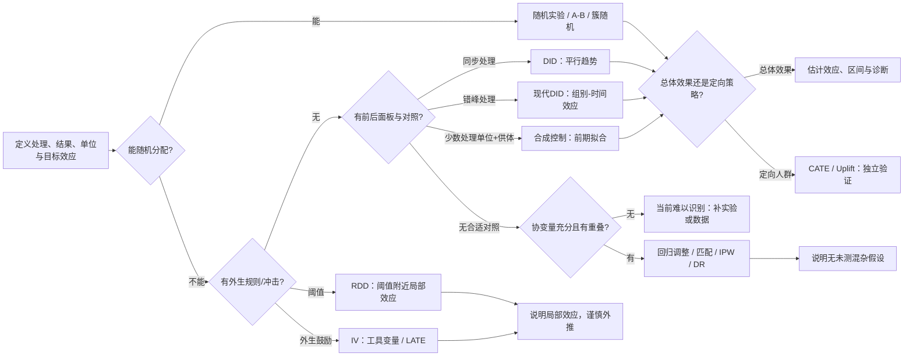

# 准实验方法索引：因果推断方法选择决策树

> [!important] 先设计，后估计
> 本图是依据数据生成机制寻找候选设计的导航，不是算法自动推荐器。先明确因果问题、目标效应和可辩护的识别假设；没有可信设计时，应报告关联或补做实验。

## 图示：从业务问题到设计

## 文字版判别

1. **可以主动分配处理吗？** 可以时优先[随机实验 / A/B 实验](../基础与识别/AB实验与因果推断的关系.md)；若用户之间互相影响，考虑簇随机或地理实验。
2. **阈值改变处理概率吗？** 考虑[断点回归（RDD）](RDD断点回归.md)。阈值附近局部效应；检查操纵和其他同步规则变化。
3. **有外生工具变量吗？** 若 $Z$ 影响处理但无其他结果路径，考虑[工具变量（IV）](IV工具变量.md)；论证独立性、相关性和排除限制，说明 LATE。
4. **有处理/对照组和前后期吗？** 考虑[双重差分（DID）](DID双重差分.md)，论证平行趋势、排除同期差异冲击；错峰上线选择合适现代估计量，不机械用传统 TWFE。
5. **少数处理市场但有多个供体和长前期吗？** 考虑[合成控制法（SCM）](合成控制法SCM.md)，先检查处理前拟合和供体污染。
6. **只能做观察性比较？** 处理前协变量充分、组间重叠且可以辩护无未测混杂时，可先看[匹配与倾向得分（PSM）](Matching与PSM.md)；回归调整、IPW 和双重稳健估计目前尚无独立专题页。PSM 不会补救未测混杂。
7. **想找高增量人群？** 先保证总体效应来源可信，再用[异质性处理效应与 Uplift](异质性处理效应与Uplift.md)并通过独立 holdout 验证策略。

## 候选方法速查

| 设计 | 数据结构 | 识别主张 | 目标量/限制 |
|---|---|---|---|
| 随机实验 | 随机处理分配 | 分配独立于潜在结果 | ITT 等；仍需考虑干扰、依从和流失 |
| DID | 处理/对照 × 前/后 | 未处理趋势平行 | 常为 ATT；不能由预趋势检验证明 |
| 现代错峰 DID | 多组、多期、处理时点不同 | 组别/时间条件平行趋势 | 需定义并汇总 cohort-time 效应 |
| RDD | 连续运行变量+阈值 | 潜在结果连续、无精确操纵 | 阈值附近局部效应 |
| IV | 外生 Z 推动 T | 相关、独立、排除；LATE 还需单调性 | 常为服从者局部效应 |
| SCM | 少数处理单位、多供体、长前期 | 加权供体拟合未处理反事实 | 单位层面效应，前拟合关键 |
| 调整/匹配/IPW | 基线协变量和重叠 | 给定 X 无未测混杂 | 目标受重叠与样本修剪影响 |
| CATE/Uplift | 可信实验或准实验数据 | 上游识别可信，异质性模型泛化 | 用于策略分配，须前瞻验证 |

## 开始分析前的停止闸门

- 处理、结果、分析单位、时间零点及目标量是否清楚？
- 对照如何产生？有无溢出、流失、同期干预或处理后控制变量？
- 假设哪些可诊断、哪些只能依赖制度/业务论证？
- 推断层级是否匹配处理分配层级？样本簇数是否够？
- 若关键假设不可信，能否降级结论或补实验？

> [!warning] 诊断不等于证明
> 例如 DID 预趋势不显著并不能保证平行趋势成立，参见 [Roth (2022)](https://doi.org/10.1257/aeri.20210236)。RDD 实践参见 [Imbens & Lemieux (2008)](https://doi.org/10.1016/j.jeconom.2007.05.001)，SCM 参见[原始比较案例研究](https://www.mit.edu/~jhainm/Paper/ccs.pdf)。

返回 [[MOC_实验方法选择]] · 本目录入口 [[MOC_实验方法选择]]
